<h1 align="center">AllyClicker</h1>

<p align="center">
  A native macOS <b>dwell-click</b> tool for head-tracker and other pointer-only users.
</p>

<p align="center">
  <a href="https://github.com/umkasanki/ally-clicker/releases/latest"></a>
  <a href="https://github.com/umkasanki/ally-clicker/releases"></a>
  
</p>

<p align="center">
  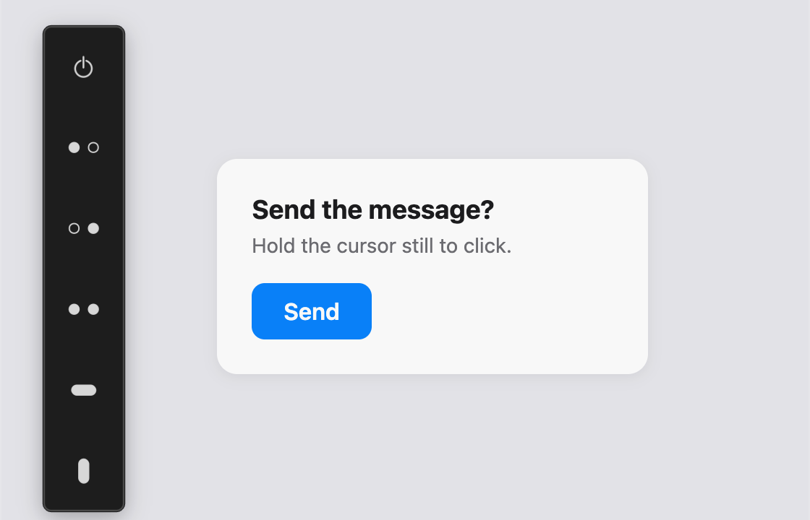
</p>

Move the cursor over a button on the floating panel, hold still for a moment — the
action arms; hold still over your target — it clicks. **No hands, no physical
buttons.** Built to replace the aging Windows *Point-N-Click* for a fully
paralyzed user.

Inspired by [Point-N-Click](https://polital.com/pnc/) by Polital Enterprises.

---

## How it works

<p align="center">
  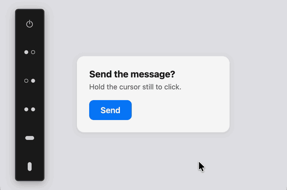
</p>

1. **Arm** — stop over a panel button. After a short dwell it turns red: that action
   is now armed.
2. **Aim** — move anywhere on screen and stop over your target.
3. **Fire** — hold still for the *AutoMouse Delay* and the armed action fires there.

Brush the panel to cancel — no dwell needed. A re-fire gate prevents machine-gun
clicks.

---

## Features

### The panel

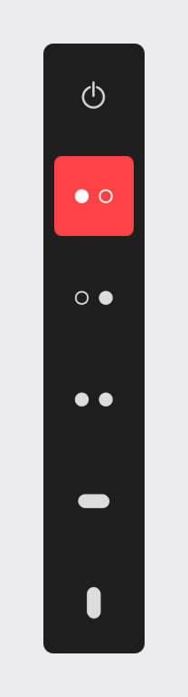

A floating, always-on-top panel with a dark native look, a sliding highlight and
smooth collapse/expand animations. It never steals focus from the app you are
working in.

| Button | Action |
|--------|--------|
| ⏻ Show / hide | Collapse/expand the panel; also its move handle |
| Left click | Single left click |
| Right click | Single right click |
| Double click | Double left click |
| Drag | Press-move-release (select text, move files, drag the panel) |
| Middle / Scroll | Middle click over a link · auto-scroll over the page |

**Default to Left Click** re-arms Left after any action fires; **Automatic Cancel**
clears the armed action after one execution instead of repeating it on every stop.

**Drag** works in two dwells: hold still at the start point until the button presses
down, move to the destination, hold still again until it releases. If the system
reports the button is no longer held, the drag gives up rather than keep a button
pressed that isn't.

<br clear="right">

### Vertical or horizontal, expanded or collapsed

<p>
  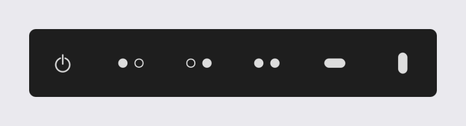
  &nbsp;
  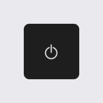
</p>

Stack the buttons in a column or a row (horizontal docks top-center by default).
Dwell the **ON/OFF** button to collapse the panel down to that one button and back;
with **Launch collapsed** it starts that way. The panel stays on screen when the
display arrangement or resolution changes.

**Move the panel hands-free:** arm **Drag**, then dwell the **ON/OFF** button — the
panel follows the cursor until you hold still to drop it. The position is remembered.

### Smart Middle and auto-scroll

<p align="center">
  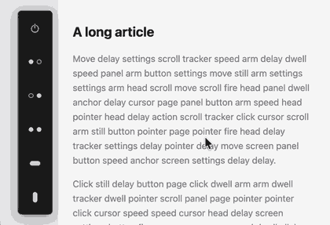
</p>

The Middle action decides by what is under the cursor:

- **Over a link** — middle-clicks it (open in a new tab).
- **Over empty page area** — starts **auto-scroll**: a red anchor drops where you
  stopped, and the page scrolls in the direction you move away from it — farther =
  faster, back toward the anchor to slow down. Tunable **intensity**. Stop moving and
  a left click fires there, ending the scroll.

### Idle-disarm

An optional safety: clear the armed action after a period with no cursor movement,
so a later stray move can't fire it. Off by default (0 = never) — the armed action
then stays until you swipe it away or pick another.

### Sound and visual feedback

Confirmation cues for when you can't feel a mouse button:

- a **click sound** when a click or drag fires, and a separate **arming
  sound** when the dwell lands on a panel button — each with its own sound and
  volume, or *None* for arming;
- your **own sounds** (WAV, AIFF, MP3, M4A, CAF), added straight from Settings —
  the bundled ones are CC0, see [their credits](macos/App/AllyClicker/Resources/Sounds/CREDITS.md);
- a brief **ripple** at the cursor when a click fires.

### Settings

Opened from the menu-bar icon. Changes apply live and are saved automatically;
**Reset to defaults** restores the factory values.

<table>
  <tr>
    <td width="50%">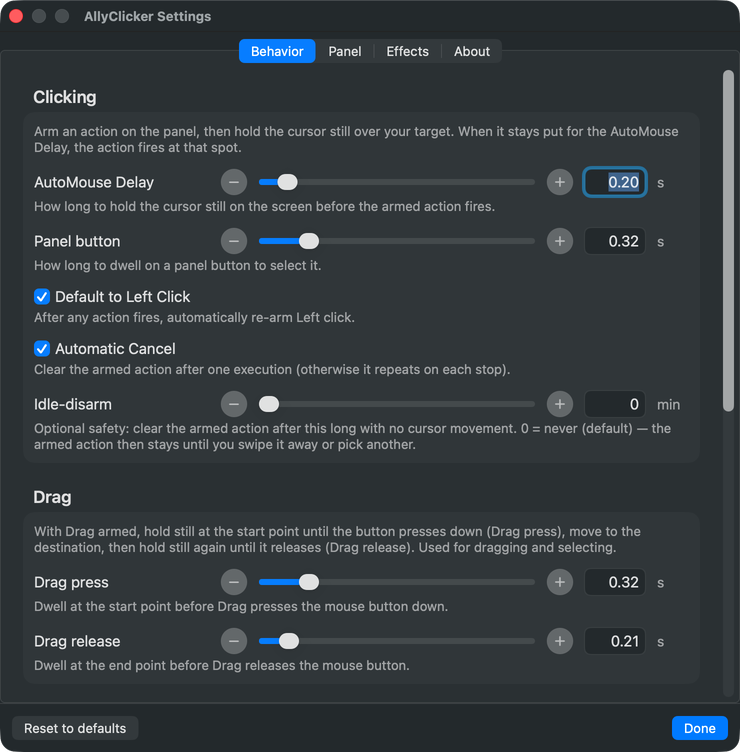</td>
    <td width="50%">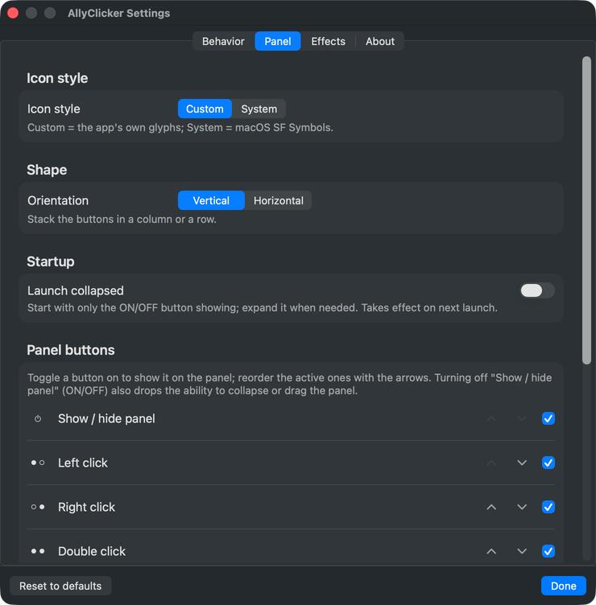</td>
  </tr>
  <tr>
    <td><b>Behavior</b> — dwell timings in 0.01 s steps: AutoMouse Delay (screen dwell),
      panel-button dwell, Drag press / release · Default to Left Click, Automatic Cancel
      · idle-disarm (minutes; 0 = never) · cursor precision: jitter tolerance + move
      threshold (tune out head-tracker tremor) · auto-scroll intensity · launch at login.</td>
    <td><b>Panel</b> — orientation, vertical or horizontal · button editor: toggle each
      button on/off and reorder the active ones. ON/OFF is pinned first but can be
      removed (Settings stays reachable from the menu bar) · icon style
      <i>Custom / System</i> and icon size · panel width and opacity · launch collapsed.</td>
  </tr>
  <tr>
    <td>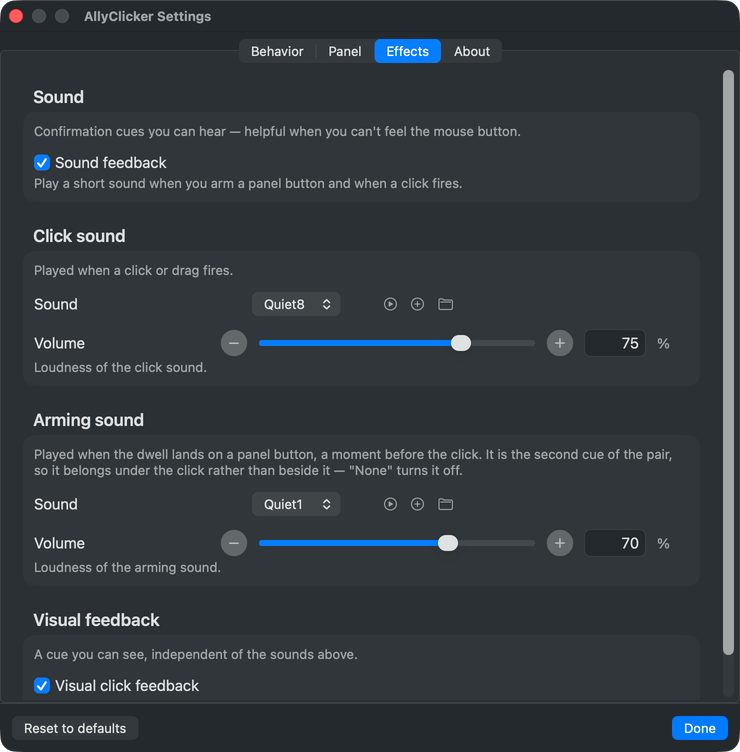</td>
    <td>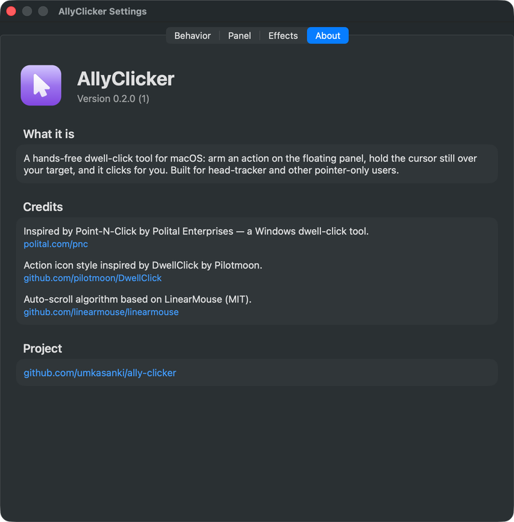</td>
  </tr>
  <tr>
    <td><b>Effects</b> — sound feedback on/off · click sound and arming sound, each with
      preview, volume and your own files · visual click feedback.</td>
    <td><b>About</b> — version, credits, project link.</td>
  </tr>
</table>

### Menu bar and login

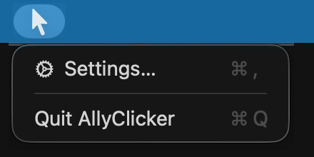

AllyClicker lives in the menu bar — no Dock icon, no app menu. The menu-bar icon is
the way to **Settings…** and **Quit**.

**Launch at login** (via `SMAppService`) starts it with your session, so the panel is
there as soon as you log in.

<br clear="right">

---

## Install

**[Full installation guide →](docs/INSTALL.md)** — what Homebrew is and how to
get it, what to do when macOS blocks the app, and how to grant the permission
it needs.

### Homebrew — recommended

```bash
brew tap umkasanki/tap
brew trust umkasanki/tap          # third-party taps are trusted once
brew install --cask allyclicker
```

Nothing stands in the way: Homebrew clears the quarantine mark as it installs.
Then allow the app to click — System Settings → Privacy & Security →
Accessibility → enable **AllyClicker**.

### .dmg — if you cannot use Homebrew

Download `AllyClicker-<version>.dmg` from the
[latest release](https://github.com/umkasanki/ally-clicker/releases/latest),
open it, and drag AllyClicker into Applications.

**macOS will refuse the first launch.** The app is signed by me rather than by
Apple, and a browser marks everything it downloads, so the refusal is expected
rather than a fault. Allow it in **System Settings → Privacy & Security →
Open Anyway**, then open the app again. Step by step, with pictures, in the
[installation guide](docs/INSTALL.md#method-2--the-dmg).

<details>
<summary><b>Build from source</b></summary>

No Xcode project needed — the app is assembled with Command Line Tools.

```bash
git clone git@github.com:umkasanki/ally-clicker.git
cd ally-clicker

./macos/App/setup-signing.sh   # once: stable self-signed identity (keeps the a11y grant)
./macos/App/install.sh         # build + install to /Applications, then launch
```

`./macos/App/build-app.sh` builds to `macos/build/AllyClicker.app` without installing.
The pure core builds and tests cross-platform via SwiftPM: `swift test`.

</details>

---

## Requirements

- macOS 14+
- **Accessibility permission** (required to inject clicks):
  System Settings → Privacy & Security → Accessibility → enable AllyClicker.

AllyClicker runs as part of your session and cannot appear on the macOS **login
window**; macOS has its own dwell clicking and on-screen keyboard that do, and
the [installation guide](docs/INSTALL.md#operating-the-login-screen) says where
to find them.

---

## For maintainers

<details>
<summary><b>Cutting a release</b></summary>

Releases are automated by [`.github/workflows/release.yml`](.github/workflows/release.yml).
Push a version tag and the workflow builds the `.dmg`, publishes a GitHub Release, and
bumps the Homebrew cask in `umkasanki/homebrew-tap`:

```bash
git tag v0.2.0 && git push origin v0.2.0
```

One-time setup: add a repo secret **`TAP_TOKEN`** — a token with **Contents: write** on
the `homebrew-tap` repo (the default `GITHUB_TOKEN` can't push to another repo).

Manual fallback: `./macos/App/make-dmg.sh` builds `macos/build/AllyClicker-<version>.dmg` and
prints its SHA-256; upload the DMG to a Release and edit the cask by hand. See
[packaging/homebrew/allyclicker.rb](packaging/homebrew/allyclicker.rb).

App icon: edit `macos/tools/AppIcon.svg`, mirror it in `macos/tools/make-icon.swift`, then
regenerate the `.icns` (see the `macos-app-icon` skill).

</details>

<details>
<summary><b>Project structure</b></summary>

A monorepo laid out one directory per platform; the behaviour contract is
[`docs/spec.md`](docs/spec.md). macOS is the only platform — the Windows port was
abandoned (see [`docs/windows-plan.md`](docs/windows-plan.md)).

```
macos/                 — the macOS app (Swift, shipping)
  Sources/AllyClickerCore/   pure logic (DwellEngine state machine, AutoScroll, Settings)
  App/AllyClicker/           AppKit panel, SwiftUI settings, CGEvent injection
  App/                       build-app.sh · install.sh · make-dmg.sh · setup-signing.sh
  Tests/AllyClickerTests/    unit tests (dwell engine, settings, panel commands)
  tools/                     app-icon SVG source + CoreGraphics generator
docs/                  — spec (shared contract), plans, session context
packaging/             — Homebrew cask template
```

`AllyClickerCore` has no macOS UI dependencies and is fully unit-testable (it uses
its own `Point` type, not `CGPoint`, so it builds on Linux CI too — and, as a spike
confirmed, on Windows as well).

</details>

---

## Credits

Inspired by **[Point-N-Click](https://polital.com/pnc/)** by Polital Enterprises — a Windows dwell-click tool.  
Action button icon style inspired by [DwellClick](https://github.com/pilotmoon/DwellClick) by Pilotmoon.  
Auto-scroll algorithm based on [LinearMouse](https://github.com/linearmouse/linearmouse) (MIT).
